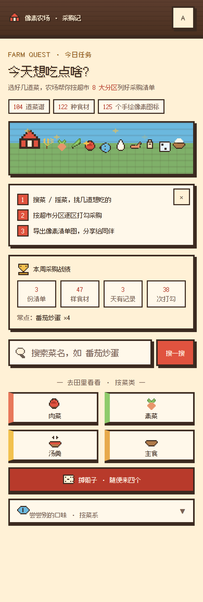
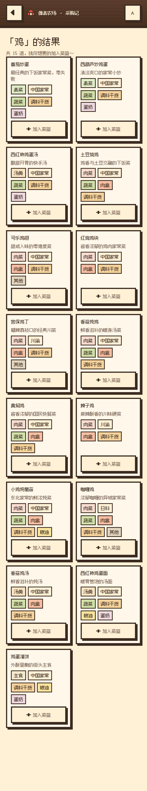
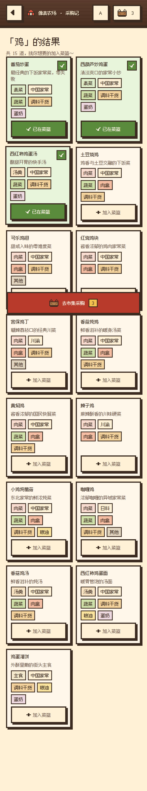
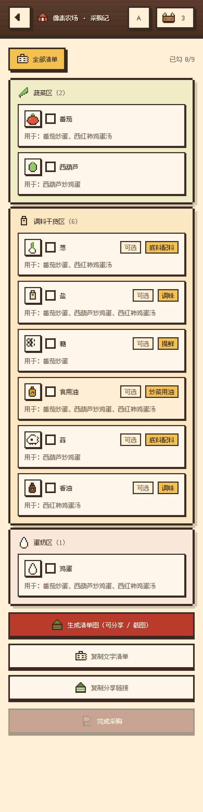
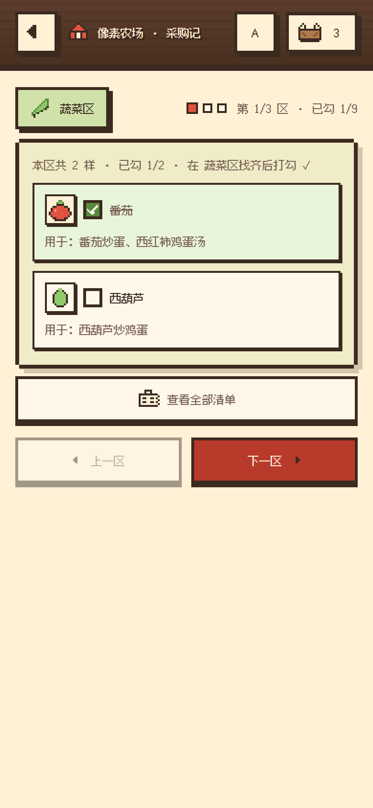
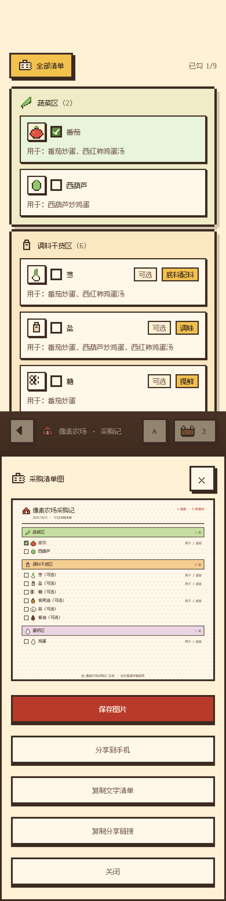
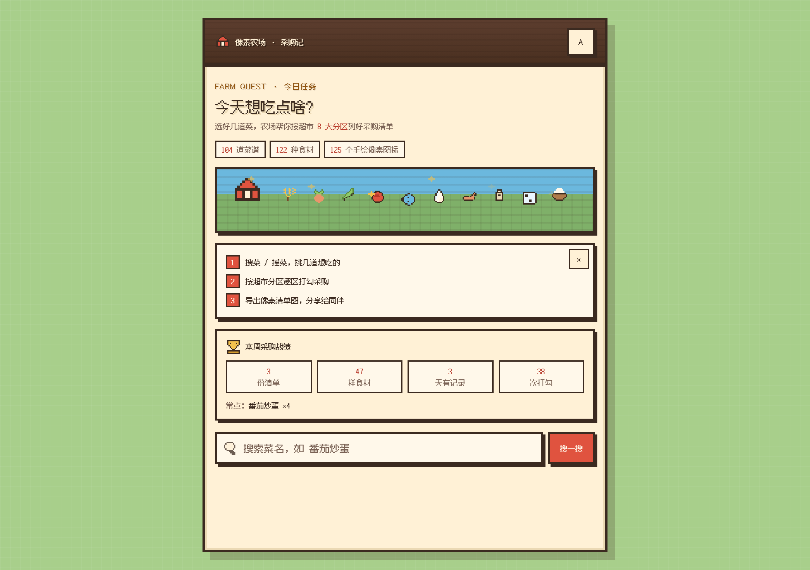
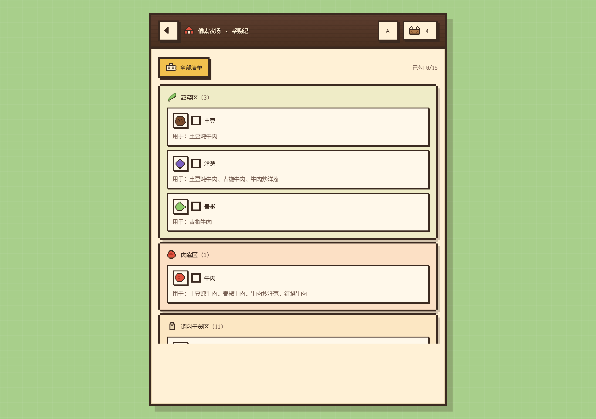

# 像素农场 · 采购记 — DESIGN.md（16-bit 农场复古版）

> 项目：超市采购辅助（菜单 Reminder）复古像素化重设计｜ 形态：静态网页（移动优先）
> 风格定调：**16-bit 农场游戏风**（参考星露谷物语 Stardew Valley 的 UI 语言：暖木框 + 奶油底 + 硬像素描边）
> 字体：Fusion Pixel 12px Proportional SC（缝合像素字体 · 简中，CDN 按 unicode-range 子集加载）
> 图标：125 个手绘 12×12 像素图标（icons.js + ingredient-icons.js，ASCII 网格 → crispEdges SVG）
> 版本：pixel-v1.0（与原 v3.1「可爱 × 时尚精致」版功能完全一致，仅视觉与文案游戏化）

---

## 0. 界面实录（docs/shots，390px 移动视口 @2x）

> 以下截图由 `assets/shots_docs.py` 自动化采集（Playwright + 预置战绩数据）。

**L1 首页 · 任务板**（场景带 / 三步引导 / 数据 chip / 战绩面板 / 搜索 / 菜类矩阵 / 掷骰子）



**L2 挑菜 · 搜索结果**（纯文字菜品卡：菜名 / 简介 / 类型·菜系 chip / 分区签 / 加入菜篮）



**L2 挑菜 · 已入篮态**（卡片变已入篮底 + ✓ 徽章，顶栏菜篮计数 + 悬浮「去采购」）



**L3b 总览 · 全部清单**（分区折叠、每样食材带像素小图标 / 可选·备注 chip / 用于哪几道菜、逐项打勾）



**L3 市集导览 · 分区闯关**（分区徽章 + 关卡进度点阵 + 本区贴士，逐区打勾）



**分享弹层 · 像素清单图**（canvas 实时生成的清单图：分区色条 + 像素勾选框，可保存 / 分享 / 复制文字清单）



**桌面布局 · 掌机隐喻**（≥680px：App 收为 640px 柱，桌面包围田地绿底 + 格纹）





---

## 1. Visual Theme & Atmosphere

- **品牌设计哲学**：把"今天想吃某道菜 → 去超市该买什么、去哪个区买"包装成一场**轻量的农场冒险**（FARM QUEST）。用户不是"填表采购"，而是"接任务 → 开盲盒 → 赶集闯关 → 通关"。
- **视觉基调**：16-bit 掌机时代的暖色农场——奶油纸底、木纹框架、番茄红主 CTA、玉米黄强调；所有元素**硬边缘、零模糊、零抗锯齿**。
- **核心视觉特征**：方块化 / 硬描边 / 偏移硬阴影 / 缺角面板 / 像素字体 / 12×12 像素图标。
- **光影与质感**：不用任何模糊阴影（box-shadow blur = 0）。深度感全部来自**实色偏移投影**（4px 4px 0 墨色）与**多重描边**；面板可用"缺角像素框"（9-slice 观感）强化复古感。
- **游戏化文案映射**：购物车→「菜篮」；随机→「掷骰子 / 盲盒」；分区翻页→「关卡 1/8」；完成→「采购通关」。

## 2. Color Palette & Roles

```css
:root{
  /* 文字与描边 */
  --c-ink: #3B2A20;          /* 墨色：所有描边/正文/硬阴影 */
  --c-ink-soft: #7A6255;     /* 弱化文字 */
  /* 木（顶栏/容器） */
  --c-wood-d: #5C3D2E; --c-wood: #A9724A; --c-wood-l: #C89B6A;
  /* 奶油/纸（表面） */
  --c-cream: #FFF1D6; --c-paper: #FFF8EA; --c-cream-d: #EBD9B4;
  /* 自然环境 */
  --c-field: #A8CF8B;        /* 桌面端外围田地 */
  --c-grass: #7FB069; --c-grass-d: #5A8A3C;
  /* 功能色 */
  --c-tomato: #E0533F; --c-tomato-d: #B83A2B; --c-tomato-l: #F5A89B;
  --c-corn: #F2C14E; --c-corn-d: #D69E2D; --c-corn-l: #FBEED3;
  --c-sky: #6BB8DE; --c-sky-d: #4A90B8;
  --c-cart-bg: #E9F5DB;      /* 已入篮/已勾选底色 */
}
```

| 角色 | HEX | 变量 | 使用场景 |
|------|-----|------|------|
| 主 CTA | #E0533F | --c-tomato | 主按钮、悬浮去采购、当前关卡点 |
| 随机/强调 | #F2C14E | --c-corn | 菜类/菜系随机砖块、徽章、提示底 |
| 成功/已选 | #5A8A3C | --c-grass-d | 已入篮、勾选、通关反馈 |
| 页面底 | #FFF1D6 | --c-cream | App 主背景 |
| 卡片底 | #FFF8EA | --c-paper | 菜品卡、输入框、清单行 |
| 顶栏 | #C89B6A→#A9724A | --c-wood-l/--c-wood | 木纹渐变 + 横向木纹条纹 |
| 外围（桌面） | #A8CF8B | --c-field | ≥680px 时 App 两侧田地 |
| 文字 | #3B2A20 | --c-ink | 全部文字与 3px 描边 |

**分区专属色（8 大超市分区，渲染层覆盖数据文件原色）**

| 分区 | 中文 | 像素图标 | 色值 |
|------|------|------|------|
| vegetable | 蔬菜 | leaf | #8FCB6B |
| meat | 肉禽 | meat | #E8785A |
| seafood | 水产 | fish | #6BB8DE |
| seasoning | 调料干货 | salt | #E8A94C |
| frozen | 冷冻 | freeze | #9AB8F0 |
| grain | 粮油 | wheat | #F2D14E |
| dairy | 蛋奶 | egg | #D9B8F0 |
| other | 其他 | box | #B8AEA2 |

分区用法：徽章底 = 分区色 42% + 奶油；面板底 = 分区色 14% + 奶油；清单图色条 = 分区色 50% + 奶油。

## 3. Typography Rules

- **Font Family**：`"Fusion Pixel 12px Proportional Simplified Chinese"`（CDN：`@vp-tw/cjk-web-fonts-fusion-pixel-font`，简体中文字子集 78 个 woff2 按 unicode-range 按需下载）；fallback `"FB-Pixel"`（`@font-face` 度量对齐：ascent 108% / descent 25%，把回退字体的行框对齐到 webfont，字体 swap 时 CLS≈0，见 styles.css I2 注释）→ `sans-serif`。
- **设计哲学**：像素字体不做字重变化（仅 400）、不做 letter-spacing 追踪（eyebrow 除外，1px）；层级完全靠字号与描边/阴影表达；正文用 12/14px（12 为字体原生网格，移动端 DPR≥2 下物理像素充足）。

| 层级 | Size | Weight | Line Height | Letter Spacing | 用途 |
|------|------|--------|-------------|----------------|------|
| Hero | 24px | 400 | 1 | 0 | 首页主标题、通关标题 |
| Title | 24px | 400 | 1 | 0 | 屏标题（12px 栅格 2 倍档） |
| Body/Button | 12px | 400 | 1 | 0 | 按钮、菜名、正文、标签、徽章 |
| Input | 16px | 400 | 1 | 0 | 表单控件例外：防 iOS 聚焦自动放大 |

> H3 整改后字号收敛为 **12 / 24 两档**（12px 是 Fusion Pixel 的原生网格，24px = 2 倍整数倍缩放不发虚）；并提供 `data-fs="lg"` 大字号档（12→16 / 24→32），localStorage `gp_fs` 记忆。

## 4. Component Stylings

**Buttons（.rbtn，按压下沉式）**
```css
.rbtn{ min-height:48px; padding:0 14px; font-size:16px; font-family:var(--font-px);
  background:var(--c-paper); color:var(--c-ink);
  border:3px solid var(--c-ink); border-radius:0;
  box-shadow:0 4px 0 var(--c-ink); cursor:pointer; }
.rbtn:active{ transform:translateY(4px); box-shadow:0 0 0 var(--c-ink); }
.rbtn.primary{ background:var(--c-tomato); color:var(--c-paper); }   /* 主 CTA */
.rbtn.ghost{ background:var(--c-paper); color:var(--c-ink-soft); }   /* 次操作 */
.rbtn.rand{ background:var(--c-corn); }                              /* 随机入口砖块 */
```
变体规则：primary 仅用于"下一步/生成/完成"；rand 专用于首页随机矩阵（min-height 60px、纵向排列 icon+文字）；:disabled 降透明度 0.45 + grayscale。

**Cards（.dish-card）**
```css
.dish-card{ background:var(--c-paper); border:3px solid var(--c-ink);
  box-shadow:4px 4px 0 var(--c-ink); padding:10px; display:flex; flex-direction:column; gap:6px; }
.dish-card:active{ transform:translate(2px,2px); box-shadow:2px 2px 0 var(--c-ink); }
.dish-card.in-cart{ background:var(--c-cart-bg); }  /* + 右上角 26px ✓ 徽章 */
```
结构（纯文字版，2026-10-19 起）：菜名 → 简介（2 行截断）→ 类型 chip（菜类淡色底）/菜系 chip（2px 描边小方块）→ 分区彩色文字小签 → 加入菜篮按钮。成品菜预览不放任何图片，与食材小图块形成明确区分。

**Inputs（.input）**
```css
.input{ background:var(--c-paper); border:3px solid var(--c-ink); border-radius:0;
  box-shadow:3px 3px 0 var(--c-ink); padding:12px 12px 12px 42px; font-size:14px; }
.input:focus{ outline:none; border-color:var(--c-tomato-d); }
```
聚焦不用光环，用主色描边；placeholder 用 --c-ink-soft。

**Navigation（.topbar）**
```css
.topbar{ position:sticky; top:0; z-index:50; padding:12px 16px;
  background: repeating-linear-gradient(0deg, rgba(0,0,0,.07) 0 2px, transparent 2px 9px),
              linear-gradient(180deg, var(--c-wood-l), var(--c-wood));
  border-bottom:3px solid var(--c-ink); box-shadow:0 3px 0 var(--c-ink); }
```
品牌名奶油色 + `text-shadow:2px 2px 0 var(--c-wood-d)`；返回/菜篮为 40px 方块按钮（3px 描边 + 3px 硬阴影）。

**Badges / Tags**
- .zone-badge / .ov-badge：分区色或玉米黄底 + 3px 描边 + 3px 硬阴影，内含像素图标 + 名称。
- .dish-meta i / .opt / .note：12px 小方块，2px 描边；note 用玉米黄底强调"底料配料/去腥"等备注。

**食材小图块（.ing-ico，L3 导览 / L3b 总览 / 清单图）**
```css
.ing-ico{ width:30px; height:30px; flex:none; display:grid; place-items:center;
  background:var(--c-paper); border:2px solid var(--c-ink); box-shadow:2px 2px 0 var(--c-ink); }
.item.checked .ing-ico{ background:var(--c-cream); }
```
食材行结构：`.ing-ico`（24px 食材像素图标，名称→图标映射见 ingredient-icons.js）→ 20px 复选框 → 名称 → 可选/备注 chip → "用于：XX"。食材图标固定不随菜品变化，与成品菜纯文字预览明确分工。
- .fc-badge：悬浮按钮上的玉米黄计数方块。

**Modals（.share-modal）**
- 遮罩 `rgba(59,42,32,.55)` 实色（无模糊）；sheet 从底部滑入（`px-slide-up .18s steps(3)`，阶梯动画保持复古帧感），3px 描边 + 顶部 4px 延伸阴影；图片预览区棋盘底纹。

**缺角像素面板（.px-notch，9-slice 观感）**
```css
.px-notch{ background:var(--c-cream); margin:4px;
  box-shadow: 0 -4px 0 0 var(--c-ink), 0 4px 0 0 var(--c-ink),
              -4px 0 0 0 var(--c-ink), 4px 0 0 0 var(--c-ink);
  filter: drop-shadow(5px 5px 0 rgba(59,42,32,.22)); }
```
用于：无匹配提示、分区面板、总览分区、通关卡片。

## 5. Layout Principles

- **间距基数**：4px；常用 8/10/12/14/16/20px。屏幕左右 padding 16px。
- **网格**：菜品卡 2 列（gap 12px）；随机矩阵 2 列（≥560px 升 4 列，gap 10px）。
- **容器**：.app max-width 640px 居中；≥680px 时左右 3px 墨框 + 两侧 10px 硬阴影，外围田地绿底 + 16px 淡格纹，形成"掌机屏幕"隐喻。
- **区块间距**：section-label 上 22px；rbtn-block 上 12px；guide-foot 上 16px。
- **留白哲学**：奶油底上保持克制留白；信息密度靠小字号（12px）标签层叠，而非压缩行距。

## 6. Depth & Elevation

| 层级 | 值 | 用途 |
|------|-----|------|
| shadow-0 | `0 0 0 var(--c-ink)` | 按钮/行 active 按压态 |
| shadow-xs | `2px 2px 0 var(--c-ink)` | 小按钮、清单行、勾选框、chip |
| shadow-card | `4px 4px 0 var(--c-ink)` | 菜品卡、悬浮去采购、大面板 |
| notch | 四向 4px 实色 + drop-shadow(5px 5px 0 22% 墨) | 缺角大面板 |

> H6 整改后阴影只留 **2px / 4px 两档**（全部落在 4px 栅格上），原 3px 档取消。

- **Surface Layers**：field（田地，桌面包围）→ cream（App 底）→ paper（卡片/输入）→ cream-d（图标砖/标签底）→ overlay（分享遮罩 55% 墨）。
- **Z-index**：topbar 50 → float-checkout 60 → share-modal 100。
- **Backdrop Effects**：禁用毛玻璃；一切层次用实色与描边表达。

## 7. Do's and Don'ts

**Do's**
1. 所有交互元素保持 ≥44px 触摸高度（按钮 48px、随机砖 60px）。
2. 按压反馈统一用 `translateY(2~4px)` + 阴影归零，模拟物理按键。
3. 图标一律走 icons.js 的 12×12 ASCII 网格 + `shape-rendering:crispEdges`，新增图标先过行宽校验。
4. 语义色（成功/警告/错误）复用农场 palette：成功=草绿深，警告=玉米黄，错误=番茄红深。
5. 分区颜色必须与清单图 canvas 输出保持一致（同一套 ZONE_COLOR 覆盖表）。
6. 隐藏元素统一依赖 `[hidden]{display:none!important}`（像素组件大量自定义 display，必须显式压过 UA）。
7. 动效使用 `steps()` 阶梯函数，保持"帧动画"质感；尊重 prefers-reduced-motion。

**Don'ts**
1. 禁止圆角（border-radius 一律 0）与模糊阴影（blur=0）。
2. 禁止引入 emoji 充当插画（与像素字形冲突，一律用像素 SVG 图标）。
3. 禁止对像素字体使用 font-weight 加粗（无粗体字形，会触发合成伪粗）。
4. 禁止大面积高饱和平铺（番茄红只做 CTA 与关键状态，不做大背景）。
5. 禁止在 canvas 清单图里混用圆角矩形/弧线（roundRect、arc 全部改为矩形 + 像素勾选）。
6. 不要给像素图标设置非整数缩放（12 的倍数：12/13/15/18/20/22/26/28/40/52 已验证清晰）。
7. 不要新增外部依赖（当前唯一外部请求是字体 CDN；离线版连它也内联了，file:// 零请求）。

## 8. Responsive Behavior

| 断点 | 行为 |
|------|------|
| <560px（移动） | 随机矩阵 2 列；菜品卡 2 列；全宽布局 |
| ≥560px（平板） | 随机矩阵 4 列 |
| ≥680px（桌面） | App 收为 640px 掌机柱：左右墨框 + 桌面包围田地底 |
| ≤380px（小屏） | 品牌名降 14px；卡片 gap 收紧 10px |

- **Touch Targets**：可点元素 ≥44px；清单行整行可点（含勾选框 20px 视觉 + 行高补偿）。
- **折叠策略**：菜系入口折叠面板（数据驱动，0 菜品系自动隐藏，如意餐当前=0）；总览页替代长滚动导览。
- **Font Scaling**：不使用 rem 相对根字号；像素字号固定 px，随 DPR 自然锐利。

## 9. Agent Prompt Guide

**Quick Reference**
```
风格：16-bit 农场复古像素（星露谷 UI 语言）
字体：Fusion Pixel 12px Proportional SC（CDN 子集），仅 400 字重，禁加粗
描边：3px solid #3B2A20；圆角：0；阴影：实色偏移（N px N px 0 #3B2A20）
主色：#E0533F（CTA）/ #F2C14E（随机强调）/ #5A8A3C（成功已选）
底色：#FFF1D6（App）/ #FFF8EA（卡片）/ #A8CF8B（桌面包围）
图标：PXIcon.svg('name', {scale: N})，125 个 12×12 像素图标（33 UI + 92 食材，食材映射见 ingredient-icons.js）
面板：大面板用 .px-notch 缺角框；按压：translateY(4px)+阴影归零
禁忌：无圆角/无模糊阴影/无 emoji/无渐变文字
```

**Component Prompts（可直接复制）**
1. `生成一个像素风主按钮：番茄红底 #E0533F、奶油字 #FFF8EA、3px 墨色描边、4px 实色下沉阴影、active 时 translateY(4px) 阴影归零，min-height 48px，字号 16px 像素字体。`
2. `生成一张菜品卡（纯文字版）：纸底 #FFF8EA、3px 墨框、4px 硬阴影；无图片层——菜名 16px、两行简介 12px、类型 chip（菜类淡色底）/菜系 chip、分区彩色文字小签、底部"加入菜篮"按钮；in-cart 态变 #E9F5DB 底 + 右上角 ✓ 徽章。`
3. `生成超市分区导览页：分区徽章（分区色 42% 底 + 像素图标 + "XX区"）+ 关卡进度（10px 方块点阵，当前关 12px 番茄红 + "关卡 1/8"）；缺角面板内放食材行（30px 食材像素小图块 + 20px 像素复选框 + 14px 名称 + 可选/备注 chip + "用于：XX"）。`
4. `生成通关卡片：缺角大面板居中，52px 奖杯像素图标、"采购通关！" 20px 标题、统计副文 14px、主/次按钮各一、12px 分享提示。`
5. `把现有 HTML 页面整体像素化：替换字体为 Fusion Pixel CDN；所有圆角改 0；所有 box-shadow 改实色偏移；所有 emoji 换成 12×12 像素 SVG 图标；按钮加 active 下沉；补 [hidden]{display:none!important}。`

**Iteration Guide**
1. 像素字体渲染发虚 → 检查 font-size 是否 12 的倍数（标题 24/36，正文 12/14）。
2. 隐藏元素仍显示 → 组件设置了 display，需 `[hidden]{display:none!important}`。
3. 图标发虚 → 确认 SVG 带 `shape-rendering="crispEdges"` 且 viewBox 与网格一致。
4. 颜色超出农场 palette → 回到 ZONE_COLOR 覆盖表取色，不临时造色。
5. 移动端字太小 → 优先减层级（合并 chip），不要放大正文字号破坏网格。
6. 清单图模糊 → canvas 用 S=2 缩放 + `imageSmoothingEnabled=false` + 绘制前 `document.fonts.load`。
7. 新增分区/菜类 → 同步更新 ZONE_ICON / ZONE_COLOR 与 DESIGN.md 分区表。
8. 想更"游戏感" → 加 steps() 帧动画与音效钩子，不要加渐变和发光。

---

## 附录：菜品图资产管线（dish photos → pixel art）

- **目标**：菜品卡展示具体菜品图，而非分类图标。
- **流水线**（`assets/` 目录）：
  1. `fetch_photos.py` — Wikimedia Commons `intitle:` 精确匹配 + 中文维基百科词条首图，自动收录标题含菜名的图片到 `src/<id>.jpg`（credits.json 记录许可证）。
  2. `fetch_candidates.py` — 未命中菜品的中英文候选收集（慢速避限流）到 `review/`。
  3. 人工审核 `review_sheets/sheet_*.png` → 通过的写入 `approve.json` → `python fetch_photos.py --approved` 精确下载。
  4. `pixelate.py` — PIL 流水线：中心裁方 → 色彩 ×1.18 / 对比度 ×1.06 → LANCZOS 降采样 **48×48** → MEDIANCUT 量化 **28 色无抖动** → NEAREST ×2 输出 **96×96** PNG；同时生成 `dishes/manifest.js`（`window.DISH_IMAGES`）。
  5. `make_credits.py` — credits.json → `CREDITS.md`。
- **应用接入**：`.dish-tile` 为图层结构——分类像素图标作底层，`assets/dishes/<id>.png` 覆盖层（`image-rendering:pixelated`）；仅当 id 在 `DISH_IMAGES` 中才发图请求，`onerror` 移除 img 自动回退图标。
- **设计约束**：菜品图必须与图标砖同构（1:1、3px 墨框、`object-fit:cover`）；量化色数 ≤28 保持与 UI 色板协调；不做圆角、不加滤镜描边。
- **验收标准**：主配料与菜名一致（不收含明显异料的图，如"土豆炖牛肉"不收炖排骨）；优先整菜特写，不收餐桌全景/拼盘/外卖盒。
- **当前覆盖**：**62 / 104** 道菜有像素图（57 自动+人工首批，5 为终审补充：扬州炒饭、西红柿鸡蛋面、关东煮、速冻水饺、麻辣香锅）；其余 42 道走分类图标回退。候选不足或无合格图的菜（如培根炒卷心菜、酱油炒饭、火腿炒饭、阳春面、炸酱面、三汤类）保持图标回退，宁缺毋滥。
- **⚠️ 已退役（2026-10-19 决策）**：菜品预览改为**纯文字**（菜名/简介/类型菜系/分区签），菜品照片层与 `.dish-tile` 已从应用移除，`manifest.js` 不再加载；像素图资产保留在 `assets/dishes/` 备用（如需回退图片预览，恢复 index.html 的 manifest 引用与 renderDishes 的图层结构即可）。

---

## 附录 B：食材图标系统（ingredient icons）

- **目标**：食材选择环节（L3 导览 / L3b 总览 / 清单图导出）为每种食材配**固定样式的风格化像素小图块**，与成品菜的纯文字预览形成明确区分。
- **资产**：`ingredient-icons.js` —— 92 个新增 12×12 图标 + `PXIcon.ING_ICON` 名称映射，覆盖数据集全部 **122** 种食材；8 种直接复用既有图标（胡萝卜/鸡蛋/虾/鱼/排骨/干辣椒/盐/米饭）。
- **固定样式规则**：同一食材（含切法变体：土豆/土豆片、宽粉/粉条、虾仁/虾/鲜虾/虾皮、鱼丸/虾丸/冷冻丸子、三种底料）共用同一图标；生抽/老抽用同瓶型不同色深；图标不随菜品变化。
- **渲染**：`ingIcon(name, zone)` → SVG（24px）；行结构 `.ing-ico`（30px 纸底 + 2px 墨框 + 2px 硬阴影小图块）→ 复选框 → 名称；canvas 清单图同款图标以 px=2 绘制。
- **回退**：映射未命中时按分区图标（ZONE_ICON）回退，理论覆盖率 100%（122/122 已验证）。
- **校验**：`node assets/validate_ing_icons.js` —— 行宽/行数 + 食材全覆盖 + 无失效 key。
- **新增食材流程**：在 `ingredient-icons.js` 的 `ING` 加 12×12 网格 → 在 `ING_ICON` 加名称映射 → 跑校验脚本 → 同步本表计数。
